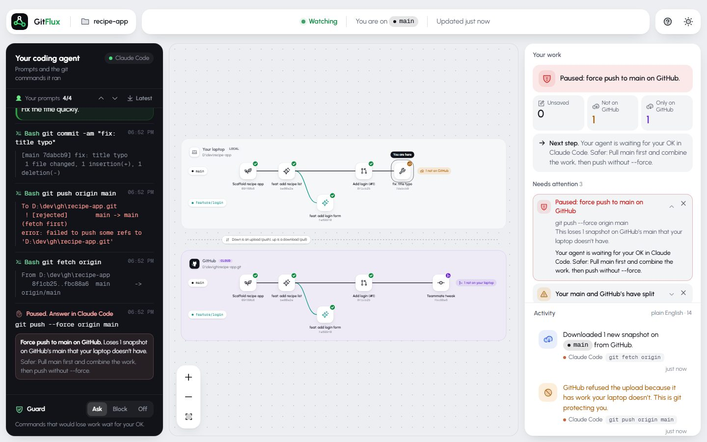
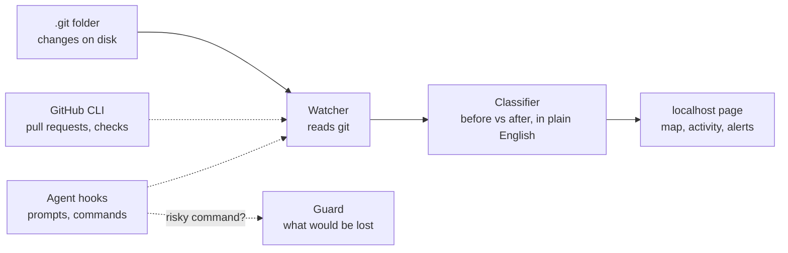

<div align="center">


# GitFlux

**See what happens to your git and GitHub, live, in plain English.**

Whether you type the commands or your AI agent does, GitFlux draws your laptop and GitHub side by side, explains every change in a sentence, and stops the commands that would lose work.

[](https://github.com/faizan-builds12/gitflux/actions/workflows/test.yml)
[](CHANGELOG.md)
[](LICENSE)
[](https://nodejs.org)
[](#by-hand-no-agent)
[](#claude-code)
[](docs/codex.md)

[Watch the video](docs/media/gitflux-explainer.mp4) · [Install](#install) · [Features](#features) · [How it works](#how-it-works) · [Is it safe?](#is-it-safe) · [Docs](docs/README.md) · [FAQ](#faq)

</div>

<p align="center">
  <a href="docs/media/gitflux-explainer.mp4"></a>
</p>
<p align="center"><sub>▶ <a href="docs/media/gitflux-explainer.mp4">Watch the 30-second video with sound</a></sub></p>
<!-- For an inline player: edit this file on github.com, drag docs/media/gitflux-explainer.mp4 onto the editor here,
     and keep the https://github.com/user-attachments/assets/… line it inserts (on its own line). -->


## Why GitFlux?

When you vibe code, you tell an agent to "make a branch, commit this, push it, open a PR" and it runs commands in a terminal you never read. When you do it yourself, git's output is just as hard to follow. Then one day a push is refused, or a teammate's work is gone, and nobody can say what happened.

GitFlux watches the repository and draws what actually happened, however the change was made: by hand in any terminal or app (VS Code, GitHub Desktop…), or by your AI agent.

- **For beginners:** see what "commit", "push" and "branch" actually do, as they happen.
- **For vibecoders:** know what your agent did to git, and get asked before it does something you can't undo.
- **For everyone:** one glance says what isn't backed up on GitHub yet.

## Install

You need [Node.js 20+](https://nodejs.org) and git. No account, no API key. Pick the way you work; all three show the same map.

| You… | Do this |
|---|---|
| type git commands yourself, or use an app like VS Code or GitHub Desktop | [By hand](#by-hand-no-agent): one command |
| use Claude Code | [Claude Code plugin](#claude-code): two commands, then it starts by itself |
| use Codex | [Codex plugin](#codex): three clicks in the app |

### By hand (no agent)

In your project folder:

```bash
npx github:faizan-builds12/gitflux
```

The map opens in your browser and follows every git change you make, from any terminal or app. Keep it running while you work; `Ctrl+C` stops it.

### Claude Code

```bash
claude plugin marketplace add faizan-builds12/gitflux
claude plugin install gitflux@gitflux
```

Start a new session. GitFlux starts with it, and the first time in a project the map opens in your browser. `/gitflux` opens it again.

### Codex

In the Codex app: **Plugins** → **Add a marketplace** → `faizan-builds12/gitflux` → install **GitFlux**. Or from a terminal:

```bash
codex plugin marketplace add faizan-builds12/gitflux
codex plugin add gitflux@gitflux
```

Approve the plugin's hooks once with `/hooks`. More in [GitFlux in Codex](docs/codex.md).

**Optional:** install the [GitHub CLI](https://cli.github.com) and run `gh auth login` to see pull requests and checks. More options, uninstalling, and connecting an agent without a plugin: [Getting started](docs/getting-started.md).

## Features

<table>
<tr>
<td width="50%" valign="top">

**🗺️ Live map**<br>
Your laptop on top, GitHub below. Each branch has its own row, and snapshots (commits) appear as they're saved. Uploads and downloads move between the two as they happen.

</td>
<td width="50%" valign="top">

**💬 Plain English**<br>
"Made a new branch `feature/login` from `main` and moved you onto it." When an agent did it, the line shows which command.

</td>
</tr>
<tr>
<td valign="top">

**🛑 Risky command guard**<br>
Before your agent runs a command that can destroy work, GitFlux checks what it would lose in *this* repo right now, and stops it with a plain reason and a safer option.

</td>
<td valign="top">

**⚠️ Needs attention**<br>
Force pushes, dropped commits, deleted unmerged branches, commits straight to main, a committed `.env`, diverged branches, detached HEAD, merge conflicts. Each one says how to fix it.

</td>
</tr>
<tr>
<td valign="top">

**🤖 Your agent's side**<br>
With a plugin, your prompts, the exact git commands and their output, next to what they did to the map.

</td>
<td valign="top">

**📖 Tour and rule book**<br>
A short tour on first open, and safe requests you can copy and paste to your agent ("save my work and back it up").

</td>
</tr>
</table>

<p align="center">
  
</p>

### The guard, in detail

> Force push to main on GitHub: this loses 1 snapshot on GitHub's main that your laptop doesn't have. Safer: Pull main first and combine the work, then push without --force.

It covers force pushes (including `+branch`), `reset --hard`, `branch -D`, `clean -f`, `checkout -- .` / `restore .`, rebasing pushed work, deleting GitHub branches, `stash drop/clear`, history rewrites and `gh repo delete`. If nothing would be lost (say, `--force-with-lease` when GitHub has nothing new), it runs without a pause. Choose the mode at the bottom of the agent panel:

- **Ask** (default): you decide before it runs. Claude Code shows its permission question. Codex can't show one to a plugin, so GitFlux stops the command and Codex asks you in the chat; if you say yes, it re-runs it as `GITFLUX_ALLOW=1 git …`, which GitFlux lets through.
- **Block**: the command is refused, and the agent is told the safer option.
- **Off**: nothing is paused.

The guard works even when the page is closed. If GitFlux can't read the repo, it stays out of the way rather than guessing. Working by hand, there's no guard (GitFlux can't stop your own terminal), but every risky moment still shows under **Needs attention**.

## How it works



Every time something in `.git` changes, GitFlux takes a snapshot with the `git` command, compares it to the last one, and turns the difference into plain-English events and alerts. The reflogs tell pushes apart from fetches and spot force pushes. Agent plugins add a hook before and after each shell command: that's how the page shows the agent's commands and how the guard can stop one before it runs.

## Is it safe?

GitFlux runs only on your computer and **never changes your repository**. It reads git, serves the page on `127.0.0.1`, and sends nothing anywhere: no analytics, no accounts. Its own notes live in `.git/gitflux/`, which git never uploads. Details in [Privacy and security](docs/privacy-and-security.md).

## Docs

| Guide | |
|---|---|
| [Getting started](docs/getting-started.md) | Every install option, uninstalling, connecting without a plugin |
| [GitFlux in Codex](docs/codex.md) | The hook approval and how the guard asks you in the chat |
| [Privacy and security](docs/privacy-and-security.md) | What GitFlux reads, stores and sends |
| [Troubleshooting](docs/troubleshooting.md) | The page didn't open, "No agent", missing pull requests |
| [Visual guide](docs/visual-guide/index.html) | Every screen explained, one git situation at a time |
| [Contributing](CONTRIBUTING.md) | Build from source, run the tests and the demo |

## FAQ

**Do I need an AI agent?**
No. Run it by hand and it maps every git change, from any terminal or app. The agent panel and the guard are extras for when an agent runs the commands.

**Which agents work?**
Claude Code and Codex have plugins. With any other agent, run GitFlux by hand: the map, activity and alerts all work; only the agent panel and the guard need hooks.

**Does it slow git down or change my repo?**
No. It only reads. The guard adds a check before risky commands, and lets everything else through untouched.

**Does it need GitHub?**
No. Without a remote it just shows your laptop. With one, it shows what's been pushed and fetched. The GitHub CLI adds pull requests and checks.

**Can I try it without touching my own project?**
Yes. Clone this repo and run `npm install && npm run build && npm run demo`: it plays a scripted agent session against a throwaway repo in `./.demo`.

## License

[MIT](LICENSE)
